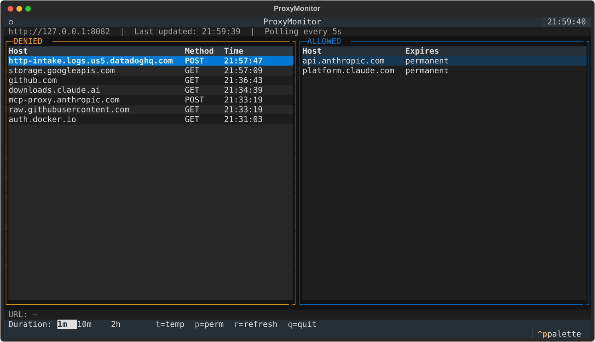

# agent-proxy

**Warning:** This is an experimental more-or-less vibe-coded project. I've had a look a the code, but haven't thoroughly vetted it.

mitmproxy addon that acts as the sole HTTP/HTTPS egress point for an LLM agent sandbox. Enforces a domain allowlist, brokers API credentials so real secrets never enter the sandbox, strips unwanted `Set-Cookie` response headers, and exposes a management API for runtime changes.

## Setup

```
uv sync
```

## Run

```bash
# headless
uv run mitmdump -s addon.py

# with web UI
uv run mitmweb -s addon.py
```

Point the agent at the proxy and install the CA cert:

```bash
export HTTP_PROXY=http://127.0.0.1:8080
export HTTPS_PROXY=http://127.0.0.1:8080
export SSL_CERT_FILE=~/.mitmproxy/mitmproxy-ca-cert.pem
```

The CA cert is generated on first run at `~/.mitmproxy/` (or the path set by `--set confdir=`).

**Lima VM:** Instead of setting the env vars manually, run `setup-lima-proxy.sh` to install the CA cert into the VM's system trust store and write the proxy env to `/etc/profile.d/proxy.sh` in one step:

```bash
./setup-lima-proxy.sh [<vm-name>] [--proxy-port <port>]
```

## Configuration

**`config.yaml`** — domain allowlist and per-host options. Copy `config.default.yaml` as your starting point: it's the canonical format reference, with a worked, test-covered example of every section (`hosts` and their credentials, `services`, and the secrets file).

The options most setups touch:

- **`hosts:`** — a plain hostname (or a `{host: ...}` mapping) is unrestricted. A mapping can add `allow_response_cookies` to filter `Set-Cookie` headers: omit it to pass all through (default), `[]` to strip everything, or a list to allowlist specific cookies. See the `cookies` example in `config.default.yaml`. A host may have several entries — e.g. unauthenticated read-only access to everything plus authenticated read/write access to one repo (the `two-entries` example); the first entry that permits a request wins, and entries only ever add access.

### Service presets

One `services:` entry grants a named service exactly the egress it needs — read-only **registry presets** (`go`, `npm`, `docker`, `ghcr`, `pypi`, `crates`; full per-preset host/allows table in [docs/service-presets.md](docs/service-presets.md#presets)) or **scoped API presets** (`github`, `gitlab`) that broker a credential and restrict the host to the repos/orgs or projects/groups named under `scope:`, instead of blanket access:

```yaml
services:
  - go
  - npm
  - service: github
    scope:
      repos: [myorg/myrepo, myorg/other]
      orgs: [myorg-sandbox]           # every repo under this org
    fake_value: "ghp_…fake"           # the CLI holds the fake token, the proxy
    real_value: "${GITHUB_TOKEN}"     # swaps in the real one on the way out
```

`write: true` opts in to issue/PR/comment (or MR/note) writes; `unrestricted: true` is the explicit, logged opt-out from scoping back to blanket host access; `enabled: false` keeps an entry configured but inactive, so it can be switched back on — permanently or temporarily — from the TUI or management API. See the `services` example in `config.default.yaml` for the full option set (including self-hosted `gitlab` and `graphql`), and [docs/service-presets.md](docs/service-presets.md) for the threat model, restriction design, and known limitations.

### Custom credentials

For services without a preset, a `hosts:` entry can carry a `credential:` (header, `real_value`, optional `fake_value`), brokered only for requests that entry permits — when some other entry for the host permits a request, the credential's header is stripped instead of forwarded. Two modes: **swap mode** (the agent sends a placeholder `fake_value`; the proxy substitutes the real one before forwarding, and blocks any other non-empty value) or **inject mode** (the proxy sets the header unconditionally — omit `fake_value`). See the `credentials` example in `config.default.yaml`, which shows both forms.

**Environment variables:**

| Variable | Default | Description |
|---|---|---|
| `PROXY_CONFIG` | `config.yaml` | Path to config YAML (see `config.default.yaml` for example) |
| `PROXY_MGMT_PORT` | `8082` | Management API port the TUI connects to |

## Terminal UI

A terminal UI for monitoring and managing the proxy at runtime:

```bash
uv run python tui.py
# or with a custom port:
uv run python tui.py --port 9000
```

The port defaults to `$PROXY_MGMT_PORT` (or 8082 if unset).



The main screen is for triage, the services view for configuration. Each screen's bottom bar lists its keys and the duration selected for temporary grants.

**Main screen** — two panels:

- **Left: what's blocked, and what's open for now.** Recent denials, one row per host, newest first, followed by active temporary grants (hosts and services) with their remaining time. A denial is either *pending* (the host isn't configured) or a *violation* (it is, but the request is outside its rules). The client gets the same 503 either way, so this is the only place the difference shows. The bar below the panels shows the selected request's URL and violation reason. A denial that a disabled service would have permitted is marked and names that service; once the service is enabled, the row says so instead.
- **Right: the configured allowlist.** Unrestricted hosts, and restricted hosts with the preset (or `config`) restricting them.

| Key | Action |
|---|---|
| `t` / `p` | Temporarily / permanently allow the selected denied host |
| `e` | Temporarily enable the disabled service that would have permitted the selected denial — narrower than allowing the whole host |
| `1` `2` `3` / `d` | Select / cycle the duration for `t` and `e` |
| `s` | Open the services view |
| `Tab`, `↑`/`↓` or `k`/`j` | Switch panel, move |
| `r` / `q` | Refresh / quit |

Allowing a restricted host with `t` or `p` lifts its restrictions, but not onto its credential: out-of-scope requests go upstream without it.

**Services view** — the configured service presets, each shown as on, off or temporarily enabled. Its **Scope** column highlights `unrestricted` and unscoped flags, so blanket access stays visible.

| Key | Action |
|---|---|
| `a` | Add a service, prompting for whatever the preset needs (host, token, scope, flags). Leaving the scope blank requires confirming unrestricted access. The fake token is generated and shown; the real one is entered once, masked, and never shown again |
| `e` | Edit scope and flags (the token is untouched) |
| `o` | Rotate the real token (the fake token stays the same) |
| `space` | Turn the service on or off; its config is kept while it's off |
| `t` | Temporarily enable a disabled service for the selected duration (`1` `2` `3` / `d`). Kept in memory only, so a restart ends it |
| `x` | Remove the service and its stored secret |
| `r` / `Esc` | Refresh / back |

## Management API

Runs on `127.0.0.1:8082` (not proxied).

| Method | Path | Body | Description |
|---|---|---|---|
| GET | `/allowlist` | — | Permanent + active temporary allows, and active temporarily enabled services (`temporary_services`) |
| GET | `/denied` | — | Recent denied requests; `disabled_services` names any disabled service that would have permitted one |
| POST | `/allow/temp` | `{"host": "…", "duration_seconds": 60}` | Add TTL-based allow; `duration_seconds` defaults to 300 |
| POST | `/allow/permanent` | `{"host": "…"}` | Append to current config file and reload |
| GET | `/services/available` | — | Service preset catalog (name, needs_token, host_param, scope_params, scope_flags, header, fake prefix) |
| GET | `/services` | — | Configured services, redacted (never real tokens), with `enabled` and, while active, `temp_enabled_until` |
| POST | `/services` | `{"service": "github", "host"?: "…", "scope"?: {…}, "unrestricted"?: true, "enabled"?: false, "real_value"?: "…", <flags>}` | Add a service: generates the fake token, stores the real one in `secrets_file`, writes a `${KEY}` ref to config.yaml |
| PUT | `/services` | `{"service": "…", "host"?: "…", "real_value"?: "…", "scope"?: {…}, "unrestricted"?: true, "enabled"?: false, <flags>}` | Rotate the real token, edit scope/flags and/or toggle `enabled` in place (at least one field required); toggling ends any temporary enable |
| POST | `/services/temp-enable` | `{"service": "…", "host"?: "…", "duration_seconds": 600}` | Temporarily enable a disabled service (in memory; 409 if already enabled); repeating resets the expiry |
| DELETE | `/services` | `{"service": "…", "host"?: "…"}` | Remove the service and its stored secret |

Real credentials are write-only: accepted on POST/PUT `/services`, persisted to `secrets_file`, and never returned by any endpoint.

Endpoints report and edit the config the proxy has loaded, not whatever `config.yaml` currently holds. Reload a hand-edited `config.yaml` without restarting with `kill -HUP <pid>`; until then, API writes are refused with 409 rather than overwriting the edit.

## Tests

```bash
uv run pytest            # unit tests
uv run pytest test_functional.py -v   # integration tests (starts real proxy)
```

## License

MIT
